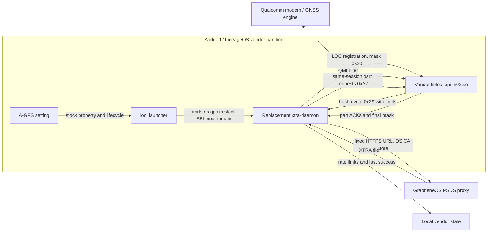

# Peridot XTRA daemon

An open-source replacement for the stock **XTRA downloader** on the Poco F6
(`peridot`) running LineageOS. XTRA supplies predicted satellite orbits as
assistance for a GNSS receiver. This daemon fetches that file from the GrapheneOS
PSDS proxy instead of delegating the fetch to the Qualcomm QCC/OMA-DM chain.

It replaces one Android vendor executable, **not** the modem firmware, GNSS HAL,
or proprietary LOC library. It does not handle, redirect or disable SUPL,
emergency location, or any other Qualcomm service. This downloader sends no
device identifiers, cell data or location in its HTTP request; the proxy can
still see the client's IP address. No claim is made about other device traffic
or GPS time to first fix.

## How it works



The daemon waits for `0x29` on its own LOC session. It validates the event and
downloads once from the fixed proxy URL, with peer and hostname verification,
no redirects and no modem-supplied URLs. It sends parts of at most
`min(1024, event.maxPart)` bytes, one at a time. The checked profile is explicit
format `0`, without `fileInfo`. A success requires a status-0 ACK for each
matching part and a final mask with at least one known constellation bit.
No unsolicited send, retry of parts, status poll, or aiding-data deletion.
The stock A-GPS switch controls the existing launcher lifecycle. The daemon
does not query the setting independently.

Reviewed vendor LOC binaries are listed in [`compat/loc_profiles.json`](compat/loc_profiles.json).
Soong checks the actual Peridot vendor LOC module output and generates a pin
for that one SHA-256 and IDL minor. An unknown binary fails build-time review;
a mismatch at runtime disables the downloader without a crash/restart loop.
Updating vendor blobs may require a new ABI review. The daemon uses no periodic
timer while waiting for an event.
Attempts and rate limits are stored under `/data/vendor/location/peridot-xtra`.
The six-hour gap is a local minimum between successes, **not** a refresh
schedule or a prediction of the modem's next request.

## Verification

An earlier build of this design completed two autonomous refreshes on a Poco
F6, as recorded by its persisted success state. Those records do not establish
payload authenticity, universal hardware compatibility, or GNSS performance.
This source refactor and the Soong packaging still need Android build/image
validation before deployment.

Host tests use synthetic LOC and fake libcurl, with no network or modem access:

```sh
python3 -B -m unittest discover -s tests -p test_refresh_daemon_host.py -v
```

Use a C++17 compiler and installed libcurl headers (`pkg-config libcurl`), or
set `XTRA_CURL_INCLUDE` to the directory containing `curl/curl.h`.

## LineageOS integration

Sync this repository via the product manifest at `external/peridot-xtra-daemon`.
Select `peridot_xtra_daemon` in the Peridot product and **exclude
the old proprietary `xtra-daemon` producer**. Both modules install to
`/vendor/bin/xtra-daemon`; do not select both. See [integration notes](INTEGRATION.md).

## License

This project's source is available under the [MIT License](LICENSE).
The libcurl dependency and Qualcomm vendor components are not bundled here
and retain their own licenses.
